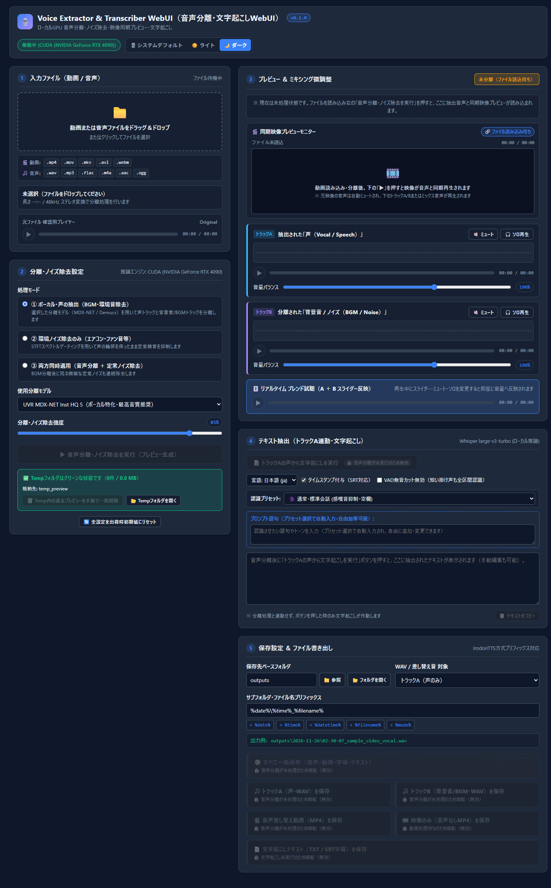
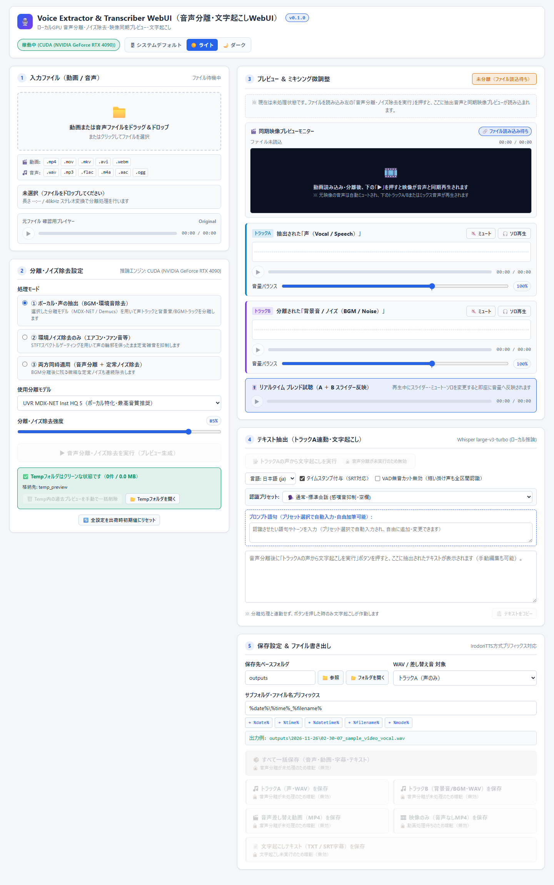
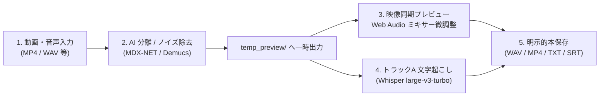
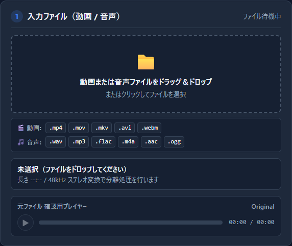
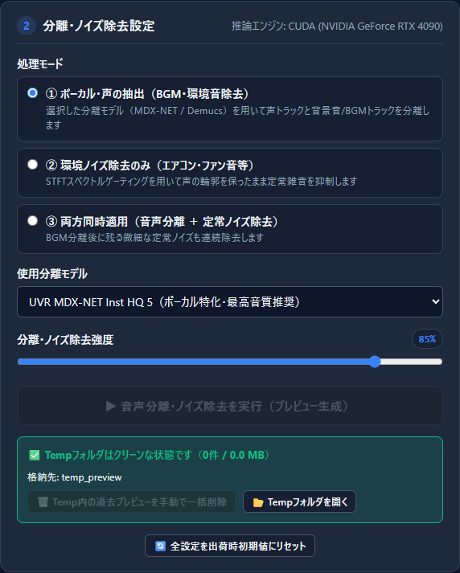
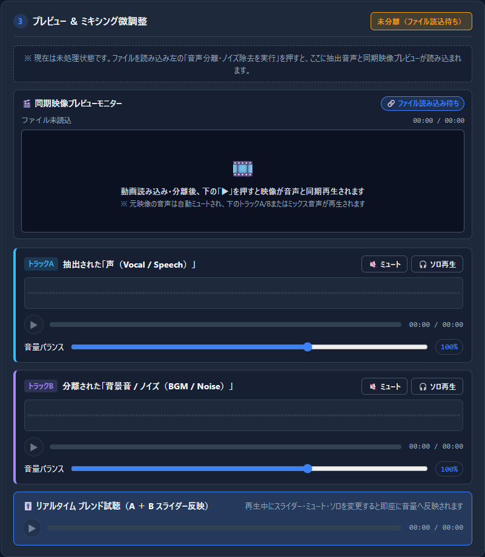
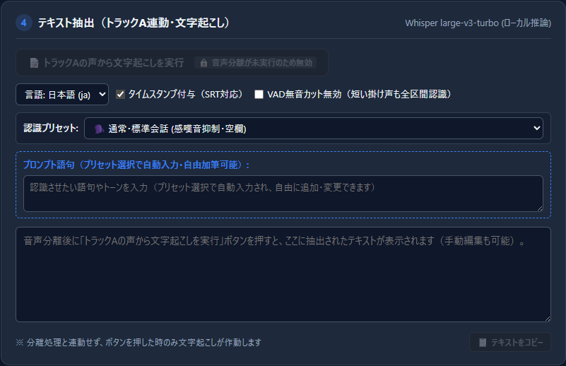
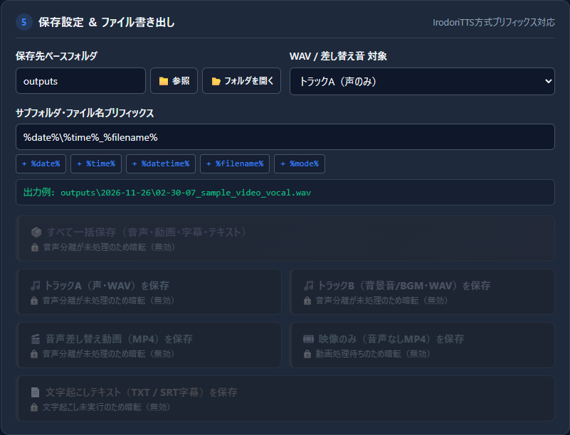

# 🎙️ Voice Extractor & Transcriber WebUI

[-blue.svg)](./CHANGELOG.md)
[](https://www.python.org/)
[](https://fastapi.tiangolo.com/)
[](https://developer.nvidia.com/cuda-zone)
[](#)

動画・音声ファイルから **「声（Vocal）」と「背景音・BGM・環境ノイズ」を高精度に分離** し、映像と同期させながらリアルタイムで試聴・音量ミキシング、さらに **ローカル GPU による文字起こし（TXT / SRT 字幕）と無劣化 MP4 書き出し** までをブラウザ上で完結できる WebUI ツールです。

[Irodori-TTS](https://github.com/fxty2006/Irodori-TTS-Enhanced-Plus) の参照音声話者ファイル（`.speaker.safetensors`）を作成する際の補助ツール（動画・音声素材からのクリーンな声抽出およびテキスト文字起こし）として、完全ローカル環境（API 課金なし・独立仮想環境 `.venv`）で動作するよう開発しています。

> [!NOTE]
> 本ツールは **現在開発中（`v0.1.0` Development Preview）** です。仕様や画面構成は今後のアップデートで変更される場合があります。変更履歴は [CHANGELOG.md](./CHANGELOG.md) をご覧ください。

---

## 🖼️ 画面プレビュー



<details>
<summary>☀️ ライトテーマ表示を確認する</summary>



</details>

---

## ✨ 主な機能

### 🎛️ AI 音声分離・ノイズ除去
- **UVR MDX-NET Inst HQ 5**（`onnx2torch` による GPU 推論・STFT/iSTFT オーバーラップ加算）を用いた高音質な声抽出
- **Hybrid Demucs (`hdemucs_high`)** による 4-Stem 音源分離も選択可能
- STFT スペクトルゲーティングによる定常ノイズ除去（単体適用／音声分離との併用）と 0〜100% の強度調整

### 🎬 映像同期リアルタイムミキサー
- 元動画の音声を自動ミュートし、分離後の **トラック A（声）** と **トラック B（背景音/BGM）** を映像と同期再生
- Web Audio API による遅延のないリアルタイム音量スライダー（0%〜150%、95〜105% スナップ吸着）・ミュート・ソロ再生
- Canvas 波形表示と波形クリックによる即時シーク、ライト / ダーク / システム自動テーマ切替

### 📝 オンデマンド文字起こし
- **Whisper `large-v3-turbo`**（`faster-whisper` 優先／`openai-whisper` フォールバック）による高速ローカル推論
- 用途別プロンプトプリセット（通常・標準会話／笑い声・感情・相槌／吐息・叫び／掛け声・アクション／カスタム手動編集）
- Silero VAD 無音カット無効化オプション（短い掛け声・単発音の拾得対応）＆ **SRT 字幕生成**

### 💾 明示的保存 ＆ 無劣化出力
- 分離時点では一時領域 `temp_preview/` にのみ生成し、未処理・対象外の保存ボタンは暗転制御
- **24bit / 48kHz PCM WAV** 出力、映像ストリーム無劣化コピーでの **音声差し替え MP4**、**映像のみ無音 MP4**、**TXT / SRT** 出力
- `%date%` / `%time%` / `%filename%` / `%mode%` 変数対応の保存パス設定（`config.json` 永続化）と一括保存ボタン

### 🛡️ 独立仮想環境 ＆ パス隔離
- プロジェクトフォルダ直下の `.venv` のみを使用し、他プロジェクトやシステム環境を汚染しません
- `PIP_CACHE_DIR` / `TORCH_HOME` / `HF_HOME` / `TEMP` / `TMP` をすべてアプリ内の `.cache/` へ固定

---

## 🔄 処理ワークフロー



---

## 📁 対応フォーマットと FFmpeg の役割

- **動画入力**：`.mp4`, `.mov`, `.mkv`, `.avi`, `.webm`
  - **動画出力**：音声差し替え MP4（映像ストリーム無劣化コピー＋選択音声）／映像のみ無音 MP4
- **音声入力**：`.wav`, `.mp3`, `.flac`, `.m4a`, `.aac`, `.ogg`
  - **音声出力**：24bit / 48kHz ステレオ PCM WAV（トラック A / トラック B / ミックス）
- **テキスト出力**：文字起こしテキスト（`.txt`）／タイムスタンプ付き字幕（`.srt`）

> [!IMPORTANT]
> **`.wav` を含む全フォーマットの読み込み・書き出しに FFmpeg を使用します。**  
> 本ツールはアップロードされた動画・音声をすべて内部で `ffmpeg` を用いて **48kHz / ステレオ / 16bit PCM WAV** へ統一正規化してから分離・プレビュー処理を行います。  
> PC 本体に FFmpeg が未導入の場合でも、`setup_venv.bat` により専用 `.venv` 内へ **`static-ffmpeg`** が自動配備されるため別途インストール不要で動作します（既にシステムへ導入済みの環境では既存の FFmpeg を優先使用します）。万一どちらも利用できない環境では、画面右上のステータスバッジが赤色で **`「ffmpeg未検出（PATHを確認してください）」`** と表示され、ファイル読込時にエラー停止します。

---

## 💻 動作要件（System Requirements）

- **OS**：Windows 10 / Windows 11 (64-bit) ※起動バッチ（`.bat`）は Windows 向けです
- **GPU**：**NVIDIA GPU（CUDA 対応、VRAM 8GB 以上推奨）**
  - 未搭載環境でも自動的に CPU モードへフォールバックしますが、実用速度には NVIDIA GPU を強く推奨します
- **GPU ドライバ / CUDA**：CUDA 12.8 以降に対応した最新の NVIDIA ドライバ（目安：570.xx 以降）
  - **CUDA Toolkit 単体のシステムインストールは不要です**（`setup_venv.bat` が専用 `.venv` 内に CUDA 版 PyTorch と CUDA 12 ランタイム DLL を直接導入します）
- **Python**：Python 3.10 〜 3.12 (64-bit、**3.12 推奨**)
  - 保存先フォルダ選択ダイアログ用に標準同梱の `tkinter` が含まれていること
- **FFmpeg / FFprobe**：**自動対応**
  - システム導入済みの場合は優先使用し、未導入環境では `setup_venv.bat` が専用 `.venv` 内に `static-ffmpeg` を自動導入します
- **空きディスク容量**：約 8GB 〜 10GB 以上（`.venv` 約 5〜6GB ＋ AI モデル重み 約 2GB ＋ 一時プレビュー領域）
- **ネットワーク**：初回セットアップ時および初回モデルダウンロード時のみ必要（モデル取得完了後は **完全オフライン動作可能**）
- **ブラウザ**：Google Chrome / Microsoft Edge / Firefox 等の最新モダンブラウザ（Web Audio API 対応）

---

## 🚀 インストール・起動・更新手順

### 1. 初回インストール（任意のドライブ・フォルダに配置可能）

インストール先フォルダの外（`C:\Users\...\AppData` 等）へキャッシュや一時ファイルを一切出さないポータブル設計のため、**C ドライブ直下（`C:\VoiceExtractorTranscriberWebUI`）でも D ドライブ直下（`D:\VoiceExtractorTranscriberWebUI`）でも、お好みの場所へ自由に配置して動作します**（システムドライブの容量を圧迫したくない場合は D ドライブ等への配置が便利です）。

```bat
cd /d D:\
git clone https://github.com/fxty2006/VoiceExtractorTranscriberWebUI.git
cd VoiceExtractorTranscriberWebUI
setup_venv.bat
```

`setup_venv.bat` を実行すると、配置したフォルダの直下に専用仮想環境 `.venv` が構築され、PyTorch（CUDA）・`onnx` / `onnx2torch`・`faster-whisper` 等の必要パッケージ導入、`static-ffmpeg` の自動確認（システム未導入時）、および分離モデル `UVR-MDX-NET-Inst_HQ_5.onnx` の取得が行われます。

### 2. 起動方法

1. フォルダ内の **`run_webui.bat`** をダブルクリックします。
2. コンソール起動と同時にブラウザで `http://127.0.0.1:7865` が自動的に開きます。

### 3. 最新版へのアップデート

本リポジトリを `git clone` で導入している場合は、フォルダ内の **`update.bat`** をダブルクリックするだけで最新コードの取得（`git pull`）と `.venv` パッケージの差分同期を自動実行できます（ユーザー設定 `config.json` や `models/`、`outputs/` は `.gitignore` 除外のため上書きされません）。

手動で更新する場合は、フォルダ内で以下を実行します：

```bat
cd /d D:\VoiceExtractorTranscriberWebUI
git pull
```

---

## 🧠 AI モデルについて（選定理由・VRAM 目安・フォールバック）

### 1. 音声分離：`UVR MDX-NET Inst HQ 5`（既定モデル）
- **採用理由**：ボーカル／声と BGM・環境音の分離において、声の輪郭削れやミュージカルノイズ（水音のような揺らぎ）が極めて少なく、セリフ・歌声ともにトップクラスの分離精度を持つため既定モデルとして採用しています。
- **VRAM 目安（8GB / 16GB 環境での動作）**：モデル重み自体が約 59MB と軽量であり、音声全体を一度に読み込まず **約 5.94 秒ごとの小チャンク分割** で GPU 推論する設計のため、ピーク VRAM 使用量は **約 1.5GB 〜 2.5GB 程度** に収まります。**VRAM 8GB や 16GB の環境でもそのまま最推奨モデルとして快適に動作します。**
- **自動取得と手動配置フォールバック**：
  - `setup_venv.bat` 実行時に、公式配布元（`TRvlvr/model_repo`）から `models/mdx_net/UVR-MDX-NET-Inst_HQ_5.onnx` へ自動ダウンロードを試みます。
  - **外部配布先の URL 変更やネットワークエラー等で自動取得に失敗した場合** は、セットアップ自体は続行されますので、別途モデルファイルを入手して以下のパスへ手動配置してください：
    ```text
    VoiceExtractorTranscriberWebUI/models/mdx_net/UVR-MDX-NET-Inst_HQ_5.onnx
    ```
  - 配置前でも、UI 上の「使用分離モデル」から組み込みの **`hdemucs_high`**（Hybrid Demucs）を選択すれば音声分離を利用できます（初回実行時に `.cache/torch/` へ自動取得されます）。

### 2. 文字起こし：`Whisper large-v3-turbo`
- **採用理由**：`large-v3` 並みの高い日本語認識精度を維持しつつ、デコーダ層を軽量化して推論速度を大幅に引き上げたモデルであり、`faster-whisper`（`float16`）実行時の VRAM 消費も **約 2GB 〜 3GB 程度** とコンパクトなため採用しています。分離モデルと合わせても **VRAM 8GB / 16GB 環境でそのまま動作します**。
- **現状仕様と自動フォールバック**：
  - 初回の文字起こし実行時に、`models/faster-whisper/`（またはフォールバック時は `models/whisper/`）へ自動ダウンロードされます。
  - 現在の `v0.1.0` ではモデル固定（`small` / `medium` 等の軽量モデルを UI から切り替える機能は未実装）ですが、万一 GPU の VRAM 不足等で実行時エラーが発生した際は、**自動的に CPU（`int8` 軽量推論）へフォールバックして処理を完走する安全機構** が組み込まれています。

---

## 📖 画面の使い方（5ステップ）

### Step 1. 入力ファイル（動画 / 音声）
- 左上のドロップゾーンに対象ファイルをドラッグ＆ドロップ（またはクリックして選択）します。元音声確認用ミニプレイヤーで事前試聴できます。



### Step 2. 分離・ノイズ除去設定
- 処理モード（①声の抽出／②環境ノイズ除去のみ／③両方同時適用）、使用モデル（`UVR MDX-NET Inst HQ 5` または `hdemucs_high`）、強度スライダーを設定し、**「▶ 音声分離・ノイズ除去を実行」** をクリックします。
- 処理状況はページ中央のプログレスモーダルにリアルタイム表示されます。
- **Temp フォルダの手動管理（過去プレビューの一括削除）**：
  - 音声分離を実行すると、試聴用の一時ファイルが `temp_preview/` へ保存されます。意図しない作業データの消失を防ぐため、**自動削除は行われません**。
  - パネル下部には現在の蓄積件数と合計容量（MB）が常に表示されます。作業完了後やディスク容量が気になるときに、**「🗑️ Temp内の過去プレビューを手動で一括削除」** ボタンから現在作業中以外の過去ファイルを一括削除できます（**「📂 Tempフォルダを開く」** からエクスプローラーで直接確認も可能です）。
- パネル最下部の **「🔄 全設定を出荷時初期値にリセット」** から、保存先や音量・プロンプト等の設定をいつでも初期状態へ戻せます。



### Step 3. プレビュー ＆ ミキシング微調整
- 分離完了後、トラック A（声）とトラック B（背景音/ノイズ）の波形が表示されます。
- ミュート・ソロ・音量スライダー（0%〜150%）を調整しながら、**「リアルタイム ブレンド試聴」** で映像と同期させたまま仕上がりを確認できます。



### Step 4. テキスト抽出（任意・オンデマンド）
- 必要に応じて言語・タイムスタンプ・VAD 無音カット無効・認識プリセット（プロンプト語句）を選び、**「📝 トラックAの声から文字起こしを実行」** を押します。抽出結果はテキスト欄上で直接編集できます。



### Step 5. 保存設定 ＆ ファイル書き出し
- 保存先フォルダ・対象（声のみ／ミックス済み／背景音のみ／個別両方）・ファイル名プリフィックスを設定し、個別の保存ボタンまたは **「📦 すべて一括保存」** から本保存を実行します。



### 保存パスプリフィックス変数

| 変数 | 展開例 | 説明 |
| :--- | :--- | :--- |
| `%date%` | `2026-11-26` | 保存実行日（`YYYY-MM-DD`） |
| `%time%` | `01-15-30` | 保存実行時刻（`HH-MM-SS`） |
| `%datetime%` | `2026-11-26_01-15-30` | 日時連結文字列 |
| `%filename%` | `sample_movie` | 入力ファイルの拡張子なしベース名 |
| `%mode%` | `vocal_extract` | 実行した処理モード識別子 |

---

## 🗂️ ディレクトリ構成

```text
VoiceExtractorTranscriberWebUI/
├── server.py                   # FastAPI / uvicorn 起動エントリーポイント (v0.1.0)
├── setup_venv.bat              # 専用仮想環境 (.venv) 構築・モデル/FFmpeg取得バッチ
├── run_webui.bat               # 環境変数隔離・ワンクリック起動バッチ
├── update.bat                  # ワンクリック更新 (git pull + .venv 依存同期) バッチ
├── requirements.txt            # 必要 Python パッケージ一覧
├── CHANGELOG.md                # バージョン別改変履歴
├── README.md                   # 本ドキュメント
├── .gitignore                  # .venv / .cache / models / temp_preview / outputs / config.json 等除外
├── docs/
│   └── images/                 # README 用画面スクリーンショット
├── app/                        # バックエンドモジュール群
│   ├── paths.py                # アプリ内キャッシュ固定・FFmpeg解決
│   ├── config_manager.py       # 初期値管理・設定読込/保存/初期化 (初回変更時に config.json を自動生成)
│   ├── prefix_resolver.py      # 保存プリフィックス変数展開
│   ├── temp_manager.py         # temp_preview/ 容量監視・手動一括削除
│   ├── job_manager.py          # 非同期ジョブ・進捗状態管理
│   ├── mdx_net_engine.py       # UVR MDX-NET (onnx2torch) GPU 推論エンジン
│   ├── audio_separator.py      # 音源分離ディスパッチ・STFTノイズ除去・波形算出
│   ├── transcriber.py          # Faster-Whisper / Whisper 文字起こし・SRT生成
│   ├── media_exporter.py       # 24bit/48kHz WAV・無劣化MP4・TXT/SRT 書き出し
│   └── api_routes.py           # FastAPI REST API・HTTP Range 配信
├── static/                     # フロントエンドモジュール群
│   ├── index.html              # 2カラムメイン画面
│   ├── css/style.css           # ライト / ダーク両対応スタイルシート
│   └── js/
│       ├── theme.js            # テーマ切替制御
│       ├── ui_state.js         # ボタン状態遷移・パスプレビュー・Temp表示制御
│       ├── audio_video_sync.js # Web Audio API ミキサー・映像同期・Canvas波形
│       └── api_client.js       # バックエンド API クライアント・進捗モーダル制御
└── tests/
    └── test_backend_modules.py # バックエンド単体・結合テスト
```

---

## 📌 バージョン情報・改変履歴

- **現在のバージョン**: **`v0.1.0`**（開発中プレビュー / 2026-11-26）
- 詳細な変更内容は **[CHANGELOG.md](./CHANGELOG.md)** を参照してください。